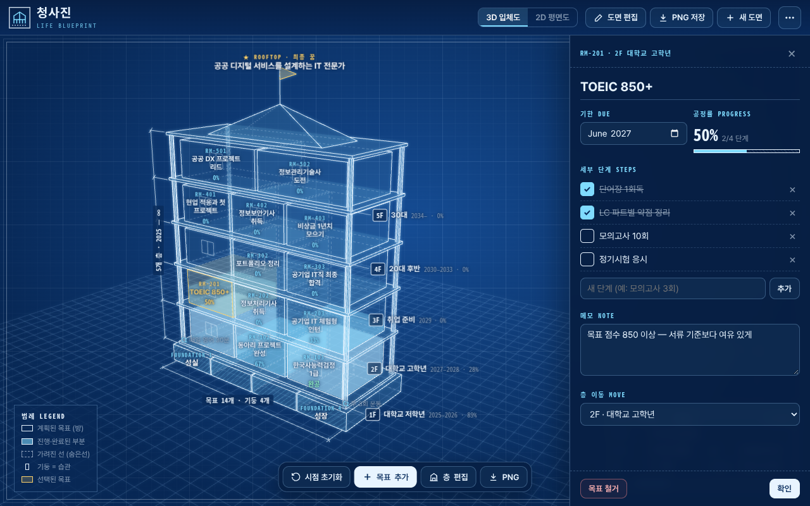
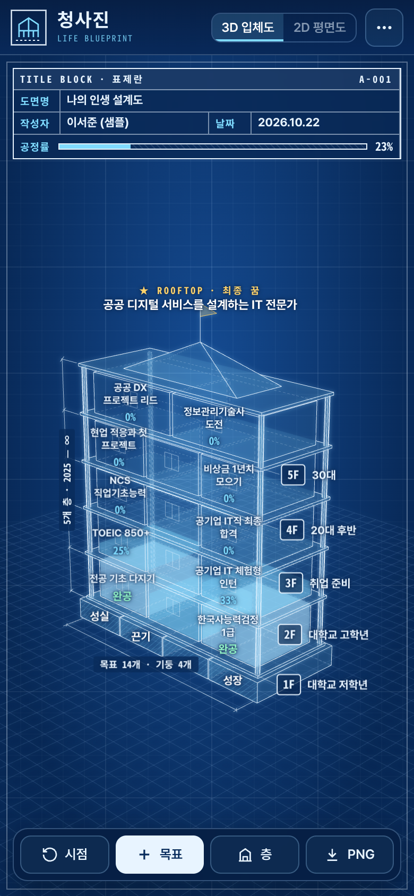

# 🏗️ 청사진 — 나의 인생 설계도

학생들이 자신의 삶을 **한 채의 건물**처럼 3D로 설계해 보는 웹앱입니다.
막연한 꿈과 목표를 눈에 보이는 구조물로 쌓아 올리며, “나는 무엇 위에, 어떤 층을, 어떻게 지어 갈까?”를 스스로 그려 봅니다.

🔗 **바로 해보기: https://sjsj331.github.io/cheongsajin/** (PC·휴대폰 모두 지원, 설치 불필요)

## 건물로 보는 인생

| 건물 요소 | 인생에서의 의미 |
|---|---|
| 🧱 기초(토대) | **가치관** — 모든 선택을 떠받치는 바탕 |
| 🏢 층 | **인생 단계** — 중·고등학생, 대학, 사회 초년생… 시간의 흐름 |
| 🚪 방 | **목표** — 각 단계에서 이루고 싶은 구체적인 일 |
| 🏛️ 기둥 | **습관** — 층과 층을 이어 건물을 버티게 하는 꾸준함 |
| 🌇 옥상 | **꿈** — 건물 꼭대기에서 바라보는 최종 비전 |

## 스크린샷

<p>


</p>

## 기술 메모

- 순수 HTML/CSS/JavaScript + [three.js](https://threejs.org) r158 (MIT) — 서버 없이 동작하는 단일 파일
- `src.html`: 개발용 원본 (three.js 자리표시자 `/*__THREE__*/` 포함)
- `build.py`: `three.min.js`를 `src.html`에 인라인해 독립 실행 가능한 `index.html` 생성

```bash
python3 build.py   # src.html + three.min.js → index.html
```
